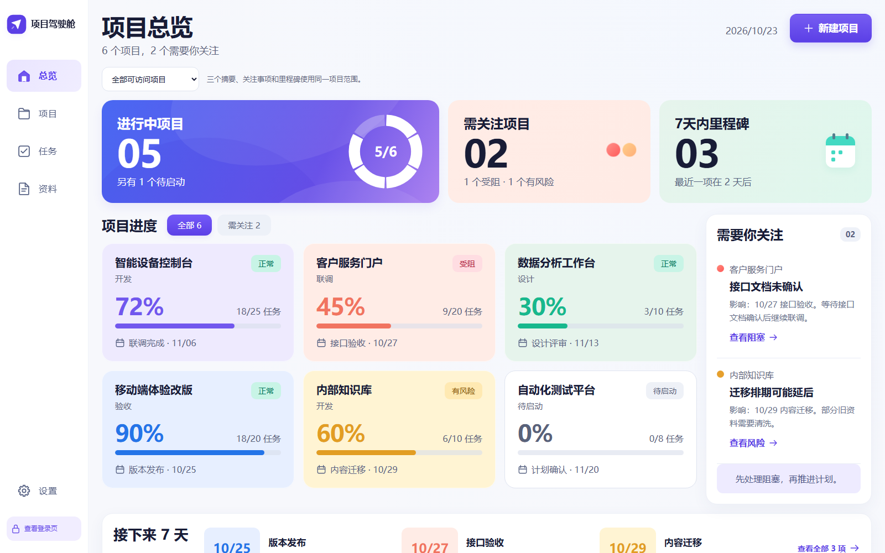
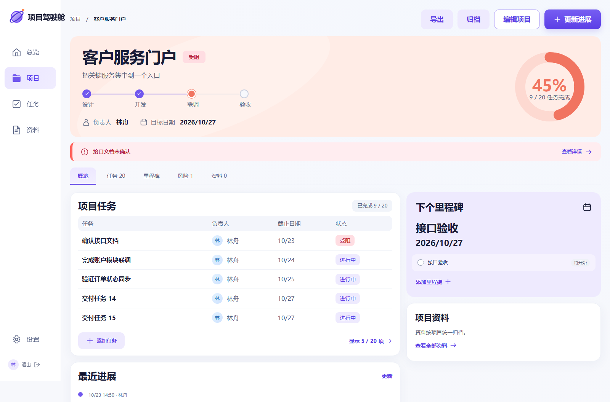
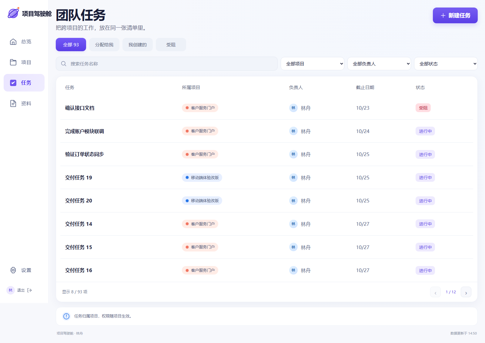
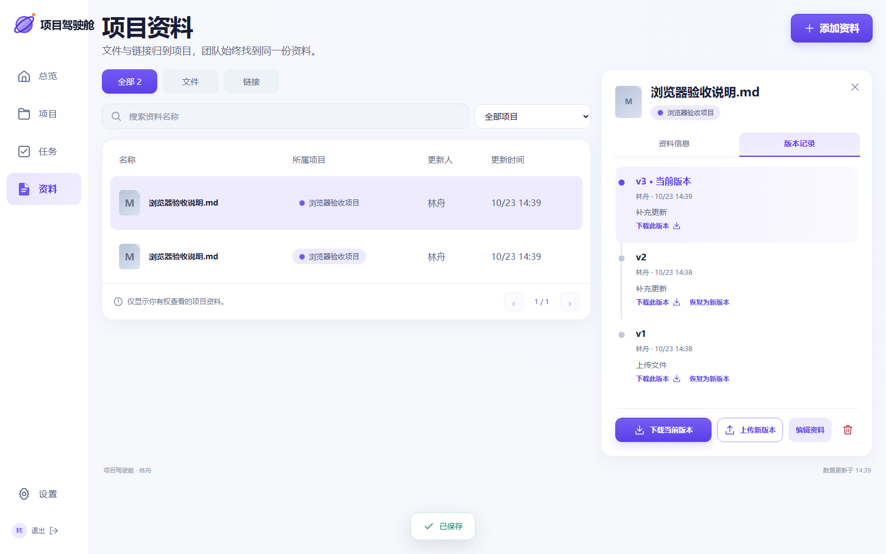
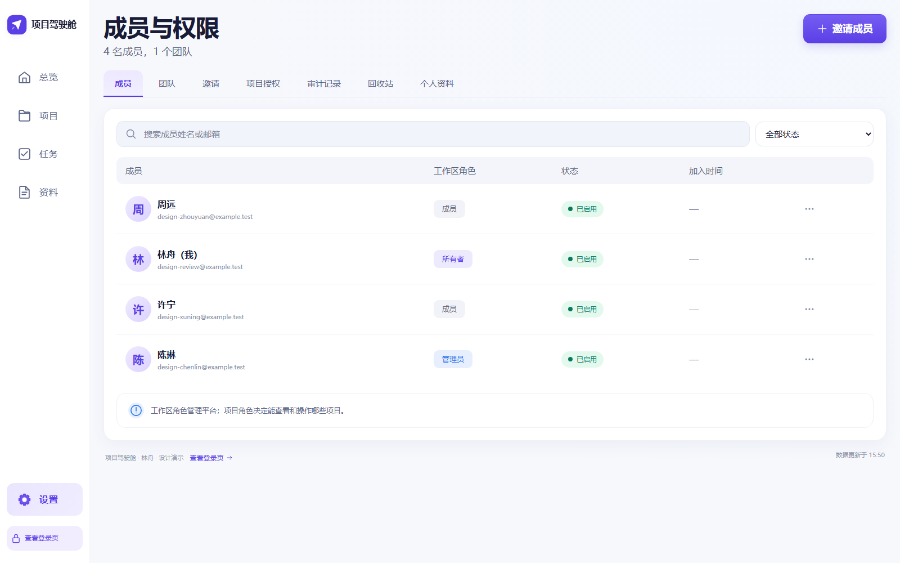
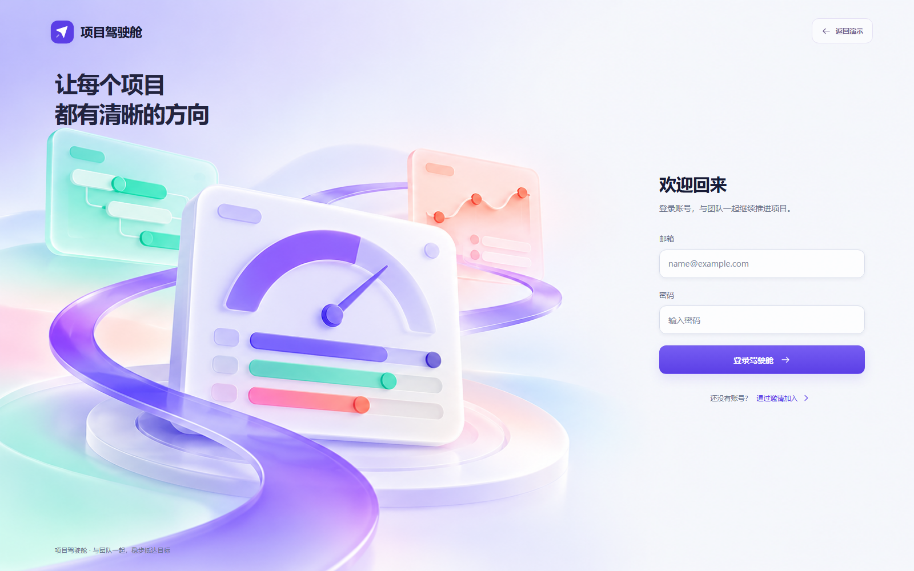
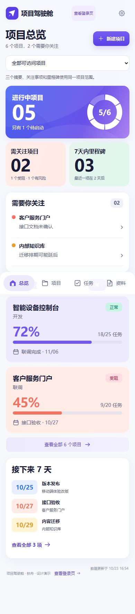

# 项目驾驶舱

**把项目进度、团队任务和卡点，放在同一个清楚的面板里。**

项目驾驶舱是一款面向多人团队的 Web 项目看板。打开总览，先看哪些项目正在推进、哪里受阻、接下来要交付什么；进入项目后，再跟进任务、风险、进展和资料版本。界面采用明亮底色与稳定的项目配色，让不同项目容易辨认，也让需要处理的问题更突出。

[在线入口](https://project-cockpit-hub.yonti9474.chatgpt.site/) · [界面展示](#界面展示) · [在本机运行](#在本机运行) · [运行与部署说明](开发/部署说明.md)

> 下图及本文画廊均为本地可运行界面的浏览器实屏，使用虚构演示项目或隔离测试数据，不是生产团队数据，也不是概念图。截图中的人数、任务数量和进度用于展示界面。



## 适合谁

- **同时推进多个项目的负责人**：想先知道哪个项目需要关注、下一项交付在什么时候，再决定今天先处理什么。
- **跨项目工作的团队成员**：需要集中查看分配给自己、自己创建或已经受阻的任务，不必逐个项目翻找。
- **需要一起维护资料的团队**：希望文件、历史版本和访问权限都归到具体项目，减少资料散落和版本混淆。

## 可以做什么

| 能力 | 实际用途 |
| --- | --- |
| 项目总览 | 汇总进行中项目、需关注项目和七天内里程碑；按全部可访问、我负责、我参与推进切换范围。 |
| 项目管理 | 维护目标、负责人、阶段、日期和项目配色；按负责人、生命周期、健康状态及团队筛选。 |
| 团队任务 | 跨项目查看任务、负责人、优先级和截止日期；支持多条件筛选、讨论，以及完成和重开历史。 |
| 风险与阻塞 | 记录原因、处理人和下一步；任务标为受阻时同步关联阻塞记录，解除时补充处理说明。 |
| 里程碑 | 查看交付节点和完成事实；未来七天的待完成事项与已逾期事项分开显示。 |
| 进展记录 | 在项目中记录这次完成了什么、下一步准备做什么，团队可以回看时间和更新人。 |
| 文件与版本 | 按项目保存文件和 HTTPS 链接；文件支持上传新版本、下载历史版本，将旧版恢复为一个新版本。 |
| 成员与权限 | 使用内置账号和邀请链接加入；分别管理工作区角色与项目角色，支持成员、团队授权、撤权和审计。 |

## 界面展示

下面展示的是同一产品在本地演示与浏览器验收中的不同页面。部分功能截图采自较早的本机版本，左上标识和筛选控件与最新总览略有差异；数据均为虚构。

### 从项目目标跟进到具体工作

| 项目详情 | 团队任务 |
| --- | --- |
|  |  |
| 在一个项目里查看目标、阶段、完成率、任务、里程碑和最近进展。 | 从项目清单进入具体工作，按负责人和状态定位要推进的任务。 |

### 文件有版本，访问有范围

| 资料版本 | 成员与权限 |
| --- | --- |
|  |  |
| 当前版与历史版同时保留；恢复旧文件会创建新版本。 | 成员通过邀请加入，项目内容按实际授权开放；图中的姓名和 example.test 邮箱都是演示信息。 |

### 登录页与手机浏览

登录页沿用同一套明亮配色，用连续背景衔接左侧视觉与右侧表单。下图为本地登录页，右上“返回演示”属于本机设计预览，正式在线版没有公开演示账号或自动登录。



<details>
<summary>查看手机总览实屏（390px，点击展开）</summary>

手机端保留摘要、关注事项、项目卡片和近期里程碑，底部导航固定在屏幕底部。下图为整页截图，包含向下滚动后可以看到的内容。



</details>

## 几个会影响使用的规则

- **阶段与百分比各自维护。** 项目阶段由维护者手动修改，例如设计、开发、联调、验收；不会随任务完成率自动跳转。完成率根据有效任务的完成情况计算，没有任务时显示“未拆任务”。
- **进度与健康状态分开看。** 有开放阻塞时项目显示受阻；没有阻塞但存在开放风险时显示有风险。完成率高，也可能仍有需要处理的问题。
- **平台角色不等于项目访问权。** 工作区所有者、管理员、成员负责平台层面的分工；项目维护者、协作成员、只读成员决定具体项目能看什么、能改什么。直接授权与团队授权同时存在时，采用最高有效角色。
- **历史继续保留。** 任务或里程碑重开后，仍能回看完成事实和状态变更；项目归档或完成后业务内容只读，维护者可重新打开。项目、任务、里程碑、风险和资料删除后可在回收站恢复。
- **保存冲突需要明确处理。** 其他人已经更新同一内容时，旧版本保存会提示冲突并保留草稿，避免静默覆盖。多人使用依靠服务端权限和版本校验，当前没有实时共同编辑光标或离线协同。

## 在线入口与账号

正式网址：**[打开项目驾驶舱](https://project-cockpit-hub.yonti9474.chatgpt.site/)**

网址可以公开打开，项目和文件仍需要内置账号及对应项目授权。**没有公开演示账号、默认密码或开放注册入口。** 团队成员由管理员创建专属邀请链接后加入；邀请链接由管理者自行交付，平台目前不自动发送邀请邮件。

全新部署尚未建立工作区时，公开首页显示“等待管理员初始化”。首位所有者使用部署者私下提供的专用链接设置账号；日常访问和分享使用上面的正式根地址。

想直接查看界面，可先看本页实屏；想独立试用，可以运行下面的本机版本。它与线上工作区的数据相互独立。

## 在本机运行

需要 **Node.js 24.14 或更新版本**。在仓库根目录打开终端，执行：

```powershell
cd 开发
npm ci
npm run build
npm start
```

打开 **http://127.0.0.1:4173**，按页面提示建立本机工作区并设置所有者账号。没有通用初始密码；默认不创建演示项目。本机所有者可以在空总览中主动导入虚构演示数据，这些数据不会自动进入线上站点。

本机业务保存在 `开发/data/cockpit.sqlite`。开发调试、Docker 自托管及备份恢复步骤见 [运行与部署说明](开发/部署说明.md)。

## 项目目录与技术实现

| 目录 | 内容 |
| --- | --- |
| [站点/project-cockpit/](站点/project-cockpit/) | 当前 Codex Sites 部署工程：React、Vinext、Cloudflare Workers；业务记录保存在 D1，私有文件版本保存在 R2。 |
| [开发/](开发/) | 可独立运行的本机版本：React、Vite、Node.js、SQLite。 |
| [需求/](需求/) | 产品需求、范围及规则。 |
| [设计/](设计/) | 视觉规范、平台设计手册与设计阶段概念图；概念图与本文浏览器实屏分开存放。 |
| [验证/](验证/) | 测试脚本、验收记录和实际界面截图。 |
| [选型报告/](选型报告/) | 与本项目有关的选型和调研资料。 |

Sites 的配置、构建和发布流程见 [云端工程说明](站点/project-cockpit/README.md)。仓库中的既有站点标识属于当前部署；部署到其他站点时，应先建立自己的站点配置和存储绑定，避免误用现有线上资源。

## 当前范围与验证边界

项目聚焦单工作区内的多项目管理。目前没有飞书自动同步、自动邮件、通用多租户或字段级权限；这些能力不应从界面名称或公开源码推断。

已保存的测试与浏览器结果见 [验收记录](验证/验收记录.md)。本机及隔离 Worker 的业务验证，与生产环境的匿名访问验证分别记录；生产登录后业务和跨发布持久化仍需在正式工作区继续核验，不能把站点发布成功等同于全部生产场景验收通过。

仓库不包含生产账号、用户数据、数据库、上传文件、会话或运行时密钥。**源码备份不等于云端业务备份**：D1 数据与 R2 私有文件需要单独管理，当前未提供自动异地备份或已演练的 D1 与 R2 联合恢复。

