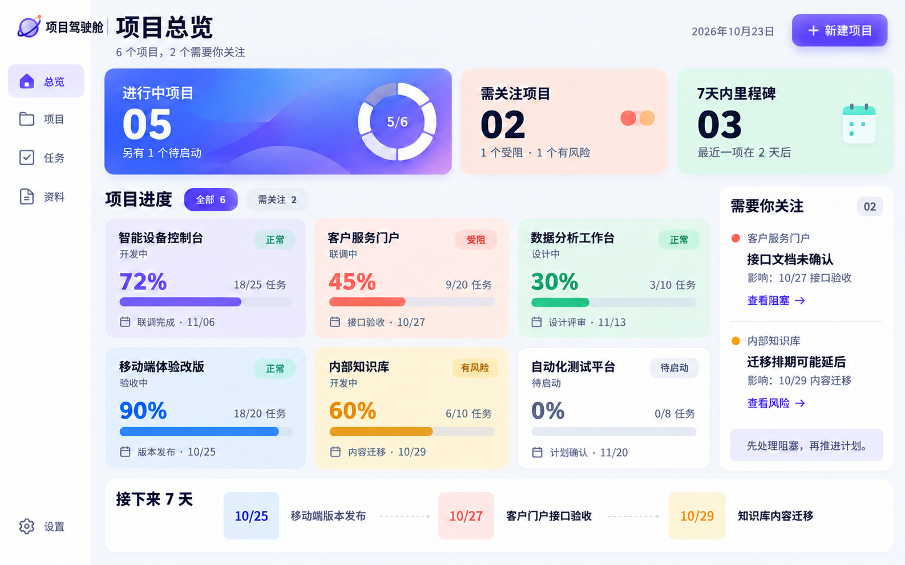
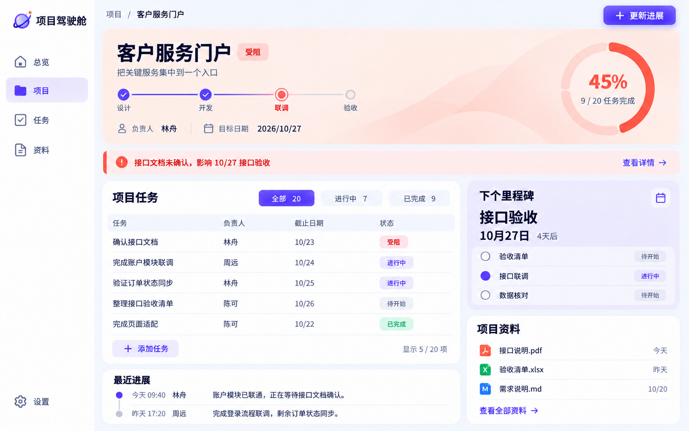
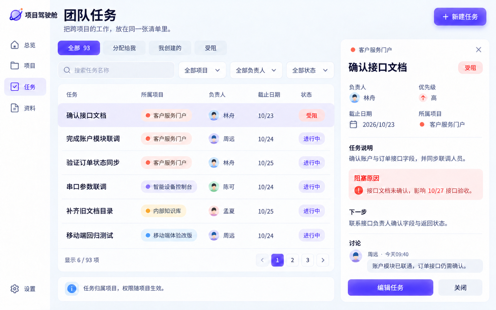
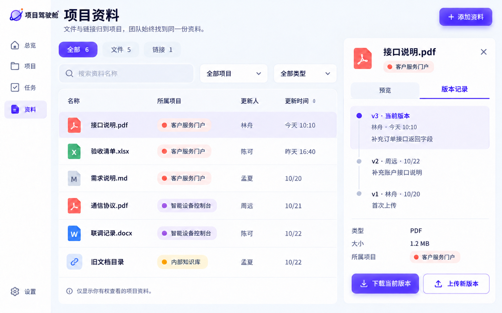
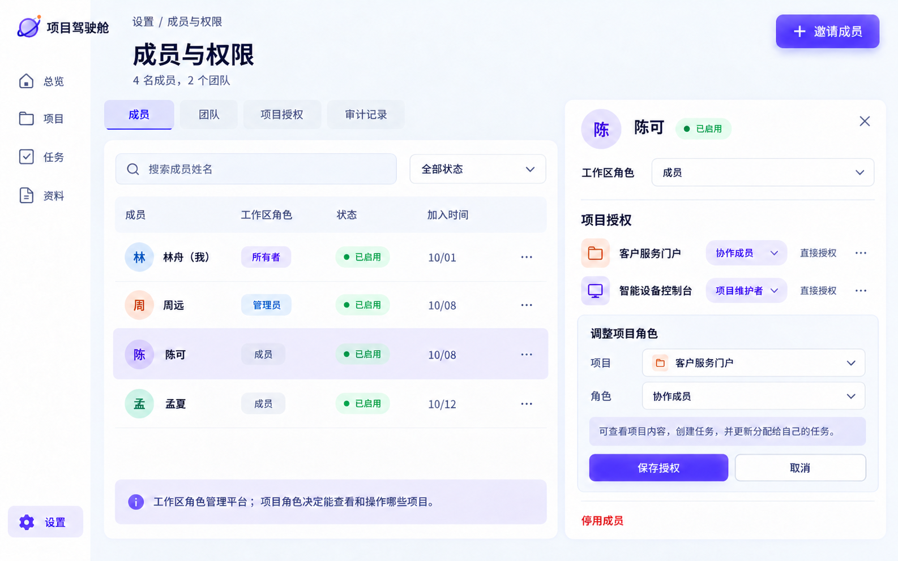

# 项目驾驶舱 · 平台设计手册

版本：V1.1 / 日期：2026-10-23 / 阶段：平台设计审阅。
已确认：产品名称“项目驾驶舱”；明亮彩色 VI 方向；多人团队；完整权限管理。
本轮修改：独立封面、名称统一、飞书逆向资料复评。正文30章，PDF含封面共31页。
待审阅：本手册新增页面、角色细则、业务规则及第25—30章的纳入建议；未自动扩大已批准范围。
阅读件：平台设计手册.pdf。业务主文件：../需求/PRD.md。视觉基准：视觉规范.md。

2026-10-23实施状态：U-13本机补齐已实现范围/多选筛选、个人事件时区、完整七天与逾期清单、任务及里程碑完成事实和完整对象历史、评论编辑软删除、审计前后值、邀请范围与交接入口。对象历史按项目读取权限，管理审计仍按管理权限。最新运行界面及测试见[验收记录](../验证/验收记录.md)；真实读屏器仍待实测。当前先交设计验收，不部署。本文与PDF/概念图并非同一次导出，待用户确认本轮标识、登录及页面效果后统一更新阅读件；第25—30章仍是候选，未自动全部纳入。

## 01 设计基准与本册用途

> 已确认的视觉方向继续沿用：瓷白空间、蓝紫焦点、彩色项目面板。平台扩展为多人协作，首页仍然保持简洁。

本册将界面、流程、数据和权限连接起来，作为后续规格与开发的共同依据。图中项目、人员、数字均为演示内容；本册不是已上线系统的操作说明。

## 02 产品边界与阅读导航

平台面向同时推进多个项目的团队。负责人用总览识别卡点，成员用任务中心开展工作，资料统一归属项目，管理员管理成员和授权。信息汇总始终以当前用户的可访问范围为准。

| 状态 | 本轮范围 | 依据 |
|---|---|---|
| 已确认 | 项目驾驶舱；明亮彩色VI方向；多人团队；完整权限管理 | U-03至U-05 |
| 设计建议 | 总览、项目、任务、资料、设置；单工作区内多个团队和项目 | REQ-001至REQ-013 |
| 设计建议 | 固定角色、项目授权、文件版本、风险闭环、审计与软删除 | 本册09至22章 |
| 后续扩展 | 任意自定义角色、字段级权限、匿名外链、多租户运营与计费 | 不混入第一版 |
| 暂不涉及 | 工时/预算/复杂审批/完整CRM/自动同步飞书/实际部署 | 延续现行范围 |

| 想了解什么 | 阅读位置 |
|---|---|
| 页面与操作 | 03—12：导航、关键路径、项目、任务、资料和成员 |
| 权限怎么生效 | 13—15：工作区角色、项目角色、授权与交接 |
| 数字怎么来、保存如何处理 | 16—22：模型、状态、统计、错误、接口与审计 |
| 怎样进入开发 | 23—24：验收示例、实施顺序与待决定项 |
| 飞书还有哪些值得借鉴 | 25—30：取舍、落地规则、资料复用与新增验收建议 |

本表按章定位，PDF第1页为封面，正文各章所在PDF页为章号加1。视觉确认不等于新增业务细则已获确认；第25—30章是本轮评估建议，是否纳入实施范围仍以之后的范围决定为准。

## 03 信息架构与页面清单

主导航保留已确认的“总览 / 项目 / 任务 / 资料”。底部“设置”根据角色显示管理入口。只有一个当前工作区；团队是成员分组，不另造一套项目空间。

| 页面编号 | 入口与建议路由 | 页面职责 |
|---|---|---|
| P-01 | 总览 /overview | 进行中、需关注、近期里程碑、重点项目 |
| P-02 | 项目 /projects | 搜索/筛选全部可访问项目、归档项目、创建项目 |
| P-03 | 项目详情 /projects/:id | 任务、里程碑、风险、进展、资料；项目设置与授权 |
| P-04 | 任务 /tasks | 跨项目清单；分配给我、我创建的、受阻；任务详情抽屉 |
| P-05 | 资料 /resources | 可访问项目的文件与链接、版本记录、预览与下载 |
| P-06 | 设置 /settings | 个人偏好；按角色显示成员、团队、授权、审计及回收站 |
| P-07 | 登录与加入 /login、/join | 登录、接受邀请、会话失效、账号停用；认证方式待选 |
| S-01—04 | 项目内状态 | 新建/编辑项目、更新进展、任务编辑、添加资料 |
| S-05—07 | 管理状态 | 邀请成员、调整角色、停用与交接、恢复资料 |

项目详情采用页内区块或标签继续承载内容，不为每个对象增加主导航。抽屉支持深链接；关闭后返回原筛选和滚动位置。无访问权限的链接统一显示“内容不存在或无权访问”，不泄露名称。

## 04 四条核心路径

| 流程 | 入口与动作 | 保存后的结果 |
|---|---|---|
| F-01 启动项目 | 新建项目 → 填目标/负责人/日期 → 选择成员或团队 → 添加任务与里程碑 | 项目进入待启动；创建者是维护者；目标日期不等于已交付 |
| F-02 推进工作 | 分配给我 → 打开任务 → 更新状态/说明 → 必要时记录阻塞 → 保存 | 更新任务与关联风险；重新计算项目进度和健康状态 |
| F-03 处理卡点 | 总览需关注 → 查看风险 → 关联任务/里程碑 → 指定处理人 → 解决并说明 | 关闭风险；若还有其他未关闭风险，项目仍保持相应状态 |
| F-04 交接成员 | 管理成员 → 停用账号 → 查看待交接项 → 移交任务和项目管理权 | 立即撤销会话与权限；历史作者保留；未完成项有新负责人 |

进入任何写入动作前先确定目标项目和操作权限。提交期间锁定当前提交按钮；只有服务端确认成功后才显示“已保存”。失败时保留输入，不能把关闭抽屉当作保存成功。

创建、授权、任务状态、风险关联更新必须形成完整事务。网络重试复用同一操作标识，防止重复创建任务或重复发出邀请。这里描述的是设计目标，本轮没有真实发送邀请或改动业务数据。

## 05 总览与项目中心

P-01沿用已确认VI的摘要、六个彩色项目面板、右侧关注区和底部里程碑。团队版范围筛选为全部可访问项目 / 我负责的 / 我参与推进的；我负责按当前项目负责人，我参与推进按当前有效维护者或协作成员角色，只读项目仍包含在全部可访问中。三个摘要和清单使用相同范围。默认显示全部可访问项目；跨会话保存筛选偏好仍属后续个人视图建议，不冒称已实现。

| 区域 | 展示与交互 | 规则 |
|---|---|---|
| 摘要 | 进行中项目、需关注项目、七天内里程碑；点击进入对应筛选 | 权限过滤先于计数；范围筛选对三个摘要同时生效 |
| 项目面板 | 名称、阶段、健康状态、进度与基数、下个里程碑 | 身份色稳定；整卡进入详情；长名最多两行 |
| 关注区 | 阻塞优先、风险其次；显示原因与受影响日期 | 按项目分组；同一项目多条问题可展开 |
| 七天清单 | 今天起七天内未完成里程碑，按日期升序 | 逾期另外标记；不把逾期项混入未来七天计数 |
| 空状态 | 没有项目、没有权限、筛选无结果分别处理 | 不以演示项目填空；保留新建或清除筛选动作 |

P-02复用同一项目面板，提供名称搜索、负责人、生命周期、健康状态、团队筛选。默认不显示归档或回收站项目；“已归档”单独入口。默认按最近业务更新排序，可切目标日期；空日期最后，同值以ID稳定排序。

项目超过首屏时分页或加载更多，不压缩字号。P-01是关注视图，P-02是完整工作清单，二者共用数据与统计口径，不维护两份项目。

## 06 新建项目与项目编辑

新建采用宽抽屉；手机改为全屏页。第一屏只放必要信息，其余以“更多设置”展开。界面沿用已确认的控件、字号、间距和角色选项。

| 字段 | 是否必填 | 约束与默认建议 |
|---|---|---|
| 项目名称 | 是 | 去首尾空格，1—80字；同名可存在，以ID区分 |
| 项目目标 | 是 | 一句话描述结果，最多500字 |
| 负责人 | 是 | 当前有效工作区成员且需有项目维护权限；默认创建者 |
| 项目身份色 | 是 | 默认从VI色板分配，可更改；不与健康状态绑定 |
| 计划开始 / 目标日期 | 否 | 日期型；同时填写时结束不早于开始；空值显示未设置 |
| 阶段 | 是 | 默认待启动；建议设计/开发/联调/验收，名称可在项目设置维护 |
| 初始成员或团队 | 否 | 逐项显示项目角色；新项目默认仅创建者可访问 |
| 资料与描述 | 否 | 创建后添加，不阻塞首次建立项目 |

创建者自动成为项目维护者。工作区策略决定普通成员是否可建项目，建议默认允许；管理员可关闭此能力。创建负责人若选他人，必须在提交时显式告知“同时授予项目维护权限”。

编辑项目不自动改变任务日期，不自动移动历史阶段记录。更换负责人、归档、移入回收站是单独动作。保存前检查并发版本；变化已被他人修改时显示差异并让用户选择，不静默覆盖。

## 07 项目详情：围绕一次交付组织信息

P-03复用VI布局：项目头、阻塞提示、任务表、里程碑、资料和进展。团队版在项目设置增加成员与授权入口，任务负责人必须来自当前项目可协作成员。项目角色决定可见动作；只读成员仍可查看相同业务内容。

## 08 团队任务中心：跨项目推进工作

P-04新增概念沿用已确认VI。93项为演示数据总量，画面展示6条；正式列表的总数必须经过项目权限过滤。右侧抽屉可直接定位任务的原因、负责人和下一步，保存后同步项目详情及总览。

## 09 任务对象与操作边界

一期任务为单层对象，必须属于一个项目。检查项只帮助执行，不额外进入进度分母。跨项目移动会改变权限、进度和资料归属，第一版不提供直接拖动移动；确需迁移由后续专门流程处理。

| 字段 | 建议规则 |
|---|---|
| 标题 / 说明 | 标题1—120字必填；说明可空，建议上限5000字 |
| 负责人 | 一人，可未分配；必须是有效且至少具备协作角色的项目成员 |
| 状态 / 优先级 | 待开始、进行中、受阻、已完成；优先级低/中/高，默认中 |
| 计划日期 / 完成时间 | 日期可空；完成时间由状态成功变更时记录；重开保留历史 |
| 关联里程碑 / 阻塞项 | 可空；只能关联本项目对象 |
| 创建人 / 更新人 / 版本 | 服务端记录；客户端不可自行改写归属与作者 |

维护者能创建、分配、改日期、取消和删除任务。协作成员可创建任务，默认分配给自己或未分配；可更新自己负责的任务，或本人创建且尚未分配的任务的说明/状态/阻塞原因。调整他人负责人、优先级和计划日期由维护者处理。

将任务标为受阻必须填写原因，并原子创建或复用一条关联阻塞记录。离开受阻状态时必须填写处理说明并关闭该任务关联阻塞；若仍有独立风险，项目不会自动变正常。已完成任务可由维护者重开，完成历史不抹除。

筛选逻辑为“不同字段取交集，同字段多值取并集”。“分配给我”只按当前负责人；“我创建的”按创建人，不等于本人永久拥有编辑权。评论新增记录，编辑保留修改时间，删除为软删除并可审计。

## 10 项目资料：同一资料有连续版本

P-05按项目聚合文件和链接。图中5个文件、1个链接均为演示内容。逻辑资料与物理版本分开：上传新版本不改变资料ID；共享的项目内链接仍指向同一资料，并明确显示当前版本。

## 11 文件、链接与版本规则

| 动作 | 行为 | 失败与权限边界 |
|---|---|---|
| 添加文件 | 选择项目 → 上传 → 填说明 → 确认成功后成为可见资料 | 未完成上传不出现在正式列表；取消清理临时上传 |
| 上传新版本 | 新增版本号、上传人、时间、说明；旧内容不可覆盖 | 冲突时提示已有更新，不能静默替换当前版本 |
| 预览 / 下载 | 每次根据当前成员状态与项目角色校验 | 猜到文件地址也不能绕过权限；原始存储不公开 |
| 回看 / 恢复旧版 | 查看历史；恢复生成新的当前版本引用 | 仅维护者可恢复；历史版本和审计继续保留 |
| 添加链接 | 保存显示名、HTTPS地址、说明与项目 | 不采集对方账号；平台无权替外站授予访问权限 |
| 删除资料 | 移入项目回收站，保留版本与关联记录 | 不级联删除任务；恢复须重新检查项目可访问状态 |

协作成员可上传资料，并对自己上传的逻辑资料添加版本或修改说明；维护者可维护所有资料。只读成员可预览和下载当前及历史版本，不能上传、恢复或删除。下载后的本地副本不能被平台远程收回；撤权阻止后续访问。

文件种类、单文件上限、总配额和病毒检查方案属于部署前待定配置，界面必须展示实际限制。上传接口核对真实大小与类型，文件名仅作显示，不作为存储路径。下载经鉴权代理；若以后采用临时下载地址，需要明确撤销窗口并另行验收。

## 12 成员与权限：让授权可理解

P-06在“设置”中提供成员、团队、项目授权与审计。图中操作者同时具备工作区所有者与演示项目维护者权限，因此能修改示例授权；真实用户不能仅因拥有工作区管理角色就获得所有项目内容。

## 13 工作区角色：管理平台，不默认读取业务

工作区角色与项目角色相互独立。工作区成员状态为邀请中、已启用、已停用；被停用者不能通过仍存在的项目授权继续访问。

| 工作区能力 | 所有者 | 管理员 | 成员 |
|---|---|---|---|
| 登录、查看个人偏好 | 是 | 是 | 是 |
| 查看项目业务内容 | 仍需项目角色 | 仍需项目角色 | 仍需项目角色 |
| 邀请普通成员、维护团队 | 是 | 是 | 否 |
| 授予/撤销工作区管理员 | 是 | 否 | 否 |
| 停用普通成员、处理邀请 | 是 | 是 | 否 |
| 停用管理员、转移工作区所有权 | 是；不能移除最后所有者 | 否 | 否 |
| 管理平台策略、查看管理审计 | 是 | 按管理范围 | 否 |
| 项目授权与业务导出 | 仍需项目维护角色 | 仍需项目维护角色 | 仍需项目维护角色 |
| 无维护者项目的应急接管 | 明确原因、再次认证、完整审计 | 否 | 否 |

第一版采用一名工作区所有者，转移须先确认新的所有者账号有效；不能让工作区失去所有者。管理员不能把自己提升为所有者，也不能通过改变请求参数绕过此限制。

所有者的应急接管是单独、显式、被审计的动作，不是隐含的全项目阅读权。接管后才产生相应项目角色。管理审计默认只包含授权与账号元信息，不展示未授权项目的任务正文或附件内容。

## 14 项目角色：读、协作、维护

每个项目有三档固定角色。没有项目授权就没有项目访问权。“负责人”是业务分工，不自动等于管理员；项目负责人需要同时具备维护者角色。

| 项目能力 | 项目维护者 | 协作成员 | 只读成员 |
|---|---|---|---|
| 查看项目、任务、风险、进展 | 是 | 是 | 是 |
| 文件预览与下载 | 是 | 是 | 是 |
| 评论、报告风险 | 是 | 是 | 否 |
| 新建任务 | 是 | 是，默认本人/未分配 | 否 |
| 更新任务说明与状态 | 所有任务 | 本人负责，或本人创建且未分配 | 否 |
| 分配他人、改计划日期/优先级 | 是 | 否 | 否 |
| 里程碑、阶段、项目目标 | 是 | 否 | 否 |
| 更新项目进展、关闭项目级风险 | 是 | 可提交进展；维护者确认项目级风险 | 否 |
| 上传资料 / 新版本 | 全部资料 | 本人上传资料 | 否 |
| 删除、恢复、取消、导出项目业务 | 是 | 否 | 否 |
| 项目成员授权、归档、重新打开 | 是 | 否 | 否 |

协作成员可关闭自己负责的任务关联阻塞，必须提交处理说明；不能借此关闭他人或项目级风险。项目访问权限适用于所有关联内容，第一版不引入同项目内的隐藏字段或单独私密附件。

维护者不能修改工作区角色；成员不能给自己加项目角色。移除最后一位有效维护者前必须指定替代者。归档项目只读，写入须先由维护者恢复；权限管理与授权撤销仍可进行。

## 15 授权来源、撤权与成员交接

授权可以直接给成员，也可以给团队。团队不是项目；把成员加到团队仅继承该团队已经被明确授予的项目角色。界面展示“直接授权 / 来自某团队”及每条来源。

| 情况 | 处理规则 |
|---|---|
| 同人有多条授权 | 取固定角色中的最高有效角色；不设置隐蔽的拒绝覆盖 |
| 移除直接授权仍有团队授权 | 明确提示仍有访问来源；要彻底移除必须处理全部来源 |
| 团队成员移除或团队授权降低 | 重新计算有效角色；后续请求立即以新角色校验 |
| 用户仍开着旧页面 | 推送或下次请求关闭内容；过期页面不能继续提交或下载 |
| 成员停用 | 立即撤销会话、下载与写入；历史作者保留；产生交接清单 |
| 负责人停用 | 当前任务标记待交接，维护者重新分配；不能静默删除任务 |
| 最后维护者被紧急停用 | 先停用保证撤权，再由所有者走应急接管；不能为了交接而继续放行账号 |

邀请建议采用有到期时间、绑定收件身份、只能接受一次的凭据。角色与项目范围在邀请页明示；接受时重新检查邀请人仍有授权能力。默认有效期建议7天，最终值由部署策略配置。失效、撤销或已接受的邀请提供清晰页面，不重复创建成员。

团队变更前显示将增加/减少的项目访问范围；敏感授权保存需二次确认，审计记录变更前后角色与来源。权限校验在服务端执行，隐藏按钮只负责界面表达。

## 16 核心数据模型

所有业务对象都有稳定ID、工作区ID、创建/更新时间、创建/更新人和并发版本。实体之间引用ID，不依靠名称关联。同名项目不会互相覆盖。

| 对象 | 关键字段与关系 | 约束 |
|---|---|---|
| Workspace / Membership | 工作区；用户、工作区角色、成员状态 | 一名有效所有者；停用优先于所有项目授权 |
| Team / TeamMember | 团队、成员关系 | 仅有效工作区成员能加入 |
| Project / ProjectGrant | 名称、目标、阶段、负责人、身份色、生命周期；成员或团队角色 | 初始仅创建者可见；项目内容按授权聚合 |
| Task | project_id、负责人、状态、日期、里程碑、说明 | 必须归属一个项目；关联对象同项目 |
| Milestone | project_id、名称、计划日期、实际完成时间 | 完成事实与计划分开；不由任务比例自动完成 |
| Risk | project_id、类型风险/阻塞、状态、原因、影响、处理人、task_id可空 | 项目健康状态由未关闭项汇总 |
| Update / Comment | 项目进展、下一步；对象讨论记录 | 作者不可伪造；修改和删除保留痕迹 |
| Resource / ResourceVersion | 逻辑资料、项目；版本号、存储键、大小、散列、上传人 | 旧版本不可覆盖；当前版本指针受并发控制 |
| AuditEvent / TrashEntry | 操作者、动作、对象、结果；软删除和恢复信息 | 审计追加写；业务删除不删除审计 |

关系：工作区包含成员、团队和项目；项目包含任务、里程碑、风险、进展、资料；任务可关联里程碑和风险；资料拥有多个版本。任何跨项目关联请求都必须拒绝，不能只校验两个ID是否存在。

## 17 生命周期与状态迁移

| 对象 | 主路径 | 回退/取消规则 |
|---|---|---|
| 项目 | 待启动 → 进行中 → 已完成 → 已归档 | 维护者可重开到进行中；归档恢复到归档前状态 |
| 任务 | 待开始 → 进行中 → 已完成 | 可进入受阻再恢复；维护者可重开或取消；取消保留历史 |
| 里程碑 | 未完成 → 已完成 | 维护者可撤销完成，保留前一次完成事件 |
| 风险/阻塞 | 待处理 → 处理中 → 已解决 | 维护者可重开；按授权允许任务负责人解决关联阻塞 |
| 资料 | 上传中 → 可用 → 回收站 | 失败不进入可用；恢复后检查项目状态 |
| 成员 | 邀请中 → 已启用 → 已停用 | 重新启用不恢复已移除授权；需要显式重新授予 |

项目健康状态为独立维度：存在未解决阻塞则“受阻”；否则有未解决风险则“有风险”；两者都无则“正常”。“已归档”是生命周期，不能作为健康状态混算。

完成项目要求有效任务全部完成、里程碑全部完成、风险全部关闭，并填写完成摘要；没有这些对象时可人工完成，但摘要仍必填。100%不自动关闭。已完成项目业务内容只读，修改先重开；归档保留完成事实与进度快照。

任务从受阻离开与其阻塞项关闭在同一事务内完成。若该任务仍有未解决关联阻塞，操作不能显示已恢复。删除里程碑时先解除关联或取消删除，不留下悬空引用。

## 18 统计口径与演示数值

| 指标 | 规则与边界 | 示例 |
|---|---|---|
| 项目进度 | 已完成有效任务 / 全部有效任务；取消/软删除排除；完成项保留 | 18/25=72%，9/20=45% |
| 百分比展示 | 非全部完成时向下取整；无有效任务显示未拆任务 | 1/3显示33%；0/0不显示0% |
| 进行中项目 | 当前范围内生命周期为进行中的项目 | 6个项目中5个进行中，分段环5/6 |
| 需关注项目 | 待启动或进行中且健康非正常的项目，按项目去重 | 1受阻+1有风险=2个项目 |
| 七天内里程碑 | 用户时区今天到第6天，尚未完成；按里程碑ID去重 | 同日不同里程碑分别计数；例含10/25、27、29 |
| 逾期 | 未完成且计划日期早于今天；无日期不判逾期 | 10/23到期当天不算逾期 |
| 下个里程碑 | 最早未完成项；逾期项优先显示并加逾期标签 | 不能跳过已逾期节点 |
| 总览摘要 | 先鉴权，再按范围筛选，最后聚合 | 未授权项目不能进入计数、候选筛选或排序 |

93项演示任务来自6个项目：25+20+10+20+10+8。完成54项：18+9+3+18+6+0。没有把六个项目百分比的平均值当作平台完成率。

日期型计划保持日历日期，不在时区换算中偏移；事件时间按UTC存储、用户时区显示。统计和列表使用同一筛选上下文与一致数据版本。权限降低时同时清理关联缓存，不能继续显示旧计数。

## 19 组件、移动端与可访问性

沿用已确认VI和design-tokens.json，不在平台手册另立色板。新增人员头像只用于辨认负责人；未上传照片时用姓名首字，不要求用户提供照片。

| 组件/场景 | 设计规则 |
|---|---|
| 导航 | 四项主导航不变；设置按角色显示；当前项同时有图标、文字和选中背景 |
| 项目面板 | 身份色稳定；状态另用标签；文字至少保留名称、进度和下一日期 |
| 表格 / 筛选 | 表头明确；排序状态可见；筛选可清除；总数经过权限过滤 |
| 抽屉 / 对话框 | 打开时焦点进入，关闭后回原触发点；Esc与关闭按钮行为一致 |
| 表单 | 错误靠近字段；必填不只用颜色；保存中禁重复，失败保留输入 |
| 手机 | 单列项目面板；任务/资料改为摘要行；复杂权限矩阵改为成员详情页 |
| 键盘 / 读屏 | 所有动作可键盘触发；焦点可见；图标有名称；状态变化能被读屏感知 |
| 动效 | 使用VI短动效；尊重减少动态效果；风险不闪烁、不自动滚动 |

桌面≥1280优先三列项目与关注栏；宽度不足时先移动关注区。768—1279两列项目；<768单列和底部导航。触摸目标至少44px，底部留出导航和安全区。

授权依赖选择的项目。手机也能修改单个成员角色，但复杂批量授权建议在桌面完成；这只是操作提示，不能导致关键撤权功能在手机缺失。

## 20 异常、并发与保存一致性

| 情况 | 用户看见什么 | 系统行为 |
|---|---|---|
| 首次无项目 | 尚未创建项目；新建入口或联系管理员 | 不加载演示数据冒充真实项目 |
| 筛选无结果 | 当前条件下没有结果；清除筛选 | 保留筛选，不误报系统为空 |
| 网络中断 | 无法刷新；上次更新时间；重试 | 保留上次成功数据，写入失败保留草稿 |
| 权限被撤回 | 内容不存在或无权访问；返回 | 清除敏感缓存，禁止继续下载和提交 |
| 两人同时编辑 | 内容已被更新；显示冲突字段 | 使用版本校验拒绝静默覆盖；提供重新加载/复制草稿 |
| 保存响应丢失 | 正在核对保存结果 | 用操作标识查询/重试，不能重复创建记录 |
| 上传失败 | 失败原因、重试或取消 | 临时文件不可见，不误增文件版本 |
| 部分批量操作失败 | 逐项结果与重试失败项 | 不把整个批次标为全成功 |

建议写入采用版本号与幂等操作标识。任务状态、关联阻塞和派生统计在同一服务事务中更新。若统计异步重算，界面显示刷新中，不能把新任务状态与旧进度混称已同步。

第一版不承诺离线编辑。浏览器内草稿可帮助恢复未提交内容，但不能作为团队数据主存储。退出账号、停用或失去项目权限时，不保留可继续读取的业务缓存。

## 21 逻辑架构与接口边界

浏览器负责呈现与输入；应用服务负责身份、权限、业务事务与统计；数据库保存业务关系；文件存储保存私有版本；审计记录独立追加。部署可在内网或云端，浏览器使用同一业务协议，不把客户操作系统与服务器部署混为一谈。

| 接口组（建议） | 典型操作 | 必须检查 |
|---|---|---|
| GET /overview、/projects | 统计、分页项目列表 | 当前成员与项目范围；计数和列表同口径 |
| POST /projects | 创建项目与初始授权 | 创建策略、负责人有效性、不可隐式公开 |
| PATCH /projects/:id | 编辑、生命周期、进展 | 项目角色、状态约束、并发版本 |
| /projects/:id/tasks | 查询、创建、更新任务 | 项目归属；负责人范围；具体字段写权限 |
| /resources/:id/versions | 上传/下载/恢复文件版本 | 项目权限、当前版本、实际文件元信息 |
| /members、/teams、/grants | 邀请、停用、团队、授权 | 工作区能力与项目能力分别校验 |
| /audit、/trash | 审计查询、软删除、恢复 | 范围隔离、不可修改审计、恢复后权限 |

上述为接口分组设计，不是已经存在的API。响应建议包含data、request_id和version；分页包含当前权限范围下的total。错误区分未登录、无权限/不存在、校验失败、版本冲突、重复操作和服务故障；不向前端输出内部堆栈。

登录优先接入选定的身份提供方或组织现有登录；若采用内置账号，则在工程阶段明确密码、重置、会话、管理员再次认证等方案。认证方式未定不影响本册权限模型，但必须在实现前确定。

## 22 审计、删除与数据恢复

| 事件 | 至少记录 | 谁能查看 |
|---|---|---|
| 登录/停用/邀请/角色变更 | 操作者、目标、时间、动作、结果、来源、原因 | 工作区所有者/管理员的管理范围 |
| 项目授权与团队来源变化 | 变更前后角色、直接/团队来源、作用项目 | 项目维护者；管理审计只显示必要元信息 |
| 任务/里程碑/风险重要变更 | 对象ID、旧值/新值、操作者、版本 | 项目维护者；项目动态提供适合成员的摘要 |
| 文件新版本/下载/恢复 | 资料与版本ID、操作人、结果 | 项目维护者 |
| 归档/删除/恢复/应急接管 | 对象、原因、时间、恢复或接管关系 | 对应管理范围 |

审计不记录密码、会话凭据或完整文件正文；日志中的对象详情同样受权限控制。审计只追加，不能让普通管理操作修改历史记录。

项目移入回收站后隐藏其业务内容与下载，保留依赖关系；恢复前检查有效维护者与成员状态，不把已停用账号重新启用。恢复不静默复活删除后明确撤销的授权。永久清理需工作区所有者明确操作，界面列出不可恢复范围；自动保留周期待确定。

业务导出由项目维护者按项目进行并记录审计，不能通过导出拿到其他项目。备份覆盖数据库、文件版本及关系索引，需恢复演练；云/内网备份位置和周期由部署方案确定。导出文件不能等同于可恢复系统备份。

## 23 验收用例与需求映射

以下是后续验收条件，不是本轮已通过的功能测试。每个用例同时检查界面反馈、数据结果和服务端权限，不只检查按钮是否隐藏。

| 用例 | 条件与操作 | 预期结果 / 关联需求 |
|---|---|---|
| A-01 总览隔离 | 用户仅有2个项目权限，访问总览与搜索 | 只显示/统计2个项目；不能看到其他名称。REQ-001、011 |
| A-02 进度边界 | 项目0任务、1/3完成、全部完成、取消任务 | 未拆任务、33%、100%；基数按规则改变。REQ-005 |
| A-03 任务越权 | 协作成员修改他人截止日期或伪造project_id | 服务端拒绝，原数据不变。REQ-009、011 |
| A-04 风险同步 | 任务受阻后恢复，但项目另有独立风险 | 关联阻塞关闭，项目仍有风险。REQ-002、004 |
| A-05 多源授权 | 移除直接授权但仍属授权团队 | 显示剩余来源；不能错误提示已彻底撤权。REQ-011 |
| A-06 撤权下载 | 账号停用后重用旧下载地址/旧页面 | 拒绝访问；清除业务内容；历史作者保留。REQ-010、011 |
| A-07 并发编辑 | 两人从同一版本保存不同日期 | 后保存者看到冲突；不静默覆盖。REQ-012 |
| A-08 文件版本 | 同时上传新版本、恢复旧版 | 版本不可覆盖；恢复生成新版本；有审计。REQ-010 |
| A-09 归档恢复 | 归档后改任务，再恢复项目 | 归档时禁止修改；恢复保留历史进度。REQ-012 |
| A-10 手机与键盘 | 390px宽、200%缩放、纯键盘核心路径 | 关键内容不遮挡、焦点可见、动作可完成。REQ-006、008 |

建议额外以100个项目、5000项任务作为开发阶段的初始性能样本，最终并发与响应目标结合团队规模确定，不能把样本规模写成当前系统已支持的容量。

## 24 进入开发前的决定与交付依据

| 待决定项 | 当前可采用的候选 | 影响 |
|---|---|---|
| 部署位置 | 公司内网服务器 / 云服务器 | 访问网络、运维、备份位置与外网入口 |
| 登录方式 | 现有企业身份 / 内置邀请账号 | P-07、账号恢复、管理员再次认证 |
| 文件存储与配额 | 服务端私有文件存储，容量按实际资料确定 | 上传限制、备份容量、预览能力 |
| 保留与恢复周期 | 回收站、文件历史、审计与备份分别配置 | 自动清理及恢复承诺，不能共用一个模糊期限 |

建议实施顺序：先身份和项目权限骨架 → 项目/任务/风险闭环 → 文件版本与团队授权 → 审计、回收站、移动端与完整验收。每一段使用本册验收条件，不先做无权限保护的完整页面再补安全逻辑。

官方Spec Kit：已验证现有Specify CLI 1.2.2的帮助和版本；本轮没有初始化工程或运行规格生成。本手册是项目设计文档，不冒充Spec Kit输出。进入工程阶段再以现行PRD和本册为输入，使用官方模板建立规格、计划、任务。

来源：U-01原始目标；U-02亮色重做；U-03采用VI并继续平台手册；U-04多人团队和完整权限；U-05正式改名、补封面并复评飞书资料。S-01至S-21覆盖主线、流程、页面原始快照及结构化字典，完整路径、定位及哈希在资料/来源索引.md。

已确认的原VI PDF及三张原图保存在制作/已确认基准，保持原字节以便对照。当前VI与六张页面图按U-05统一名称，颜色与布局方向沿用；名称更新稿不构成新增业务批准。业务细则、接口及第25—30章仍为待审阅设计。

文件入口：[现行PRD](../需求/PRD.md)、[视觉规范](视觉规范.md)、[样式值](design-tokens.json)、[来源索引](../资料/来源索引.md)、[新增页面生成提示词](制作/平台页面提示词.md)。

## 25 飞书资料复评：优先补足日常管理

复评结论：值得吸收的是交付依据、固定工作视图、周会摘要和计划变更的可追溯性。保留总览、项目、任务、资料四项主导航；扩展放进既有页面的抽屉、工具条或页内标签。下表均为建议纳入设计，尚未承诺开发。

| 建议编号 / 优先级 | 飞书证据与本项目收益 | 建议放置位置与边界 |
|---|---|---|
| E-01 优先 | 节点交付物与完成门槛；让“完成”有验收依据。S-06、10、13 | 项目里程碑抽屉：清单、资料版本、验收记录；不复制多层审批 |
| E-02 优先 | 筛选、分组、存为视图；减少重复找项目。S-13至15 | 项目/任务工具条：个人保存视图、按负责人分组；访问权不随视图扩大 |
| E-03 优先 | 项目周会、风险关注入口；减少手工整理。S-15 | 总览的周会视图：本周变化、卡点、下周里程碑；具体栏目为本项目设计 |
| E-04 优先 | 计划与实际成对字段、独立变更记录。S-03、04、11 | 项目计划与动态：基准日、当前目标、改期原因；不引入审批引擎 |
| E-05 优先 | 风险的影响范围、缓释措施、负责人。S-08、16 | 扩充现有风险抽屉：下一步、跟进日期、关闭说明；不增加首页指标 |
| E-06 次优先 | 标准/解决方案/大型交付模板并存。S-02、10 | 新建项目可选轻量预设；只复制阶段和清单，不复制权限或真实数据 |

已经吸收的内容继续保留：项目内任务/资料组织、计划与实际区分、风险关注、角色责任、对象关联。不会把这些列成“新发现”。E-01至06对应PRD的REQ-014至019，具体规则见26—28章。

复评读取了业务与流程分析，并抽查PM12、PM51、PM53原始页面快照。CSV完整解析后按相关对象检查记录；并未逐条审核全部字段，也未重新登录飞书。页面、配置、运行实测三个层次保持区分。

## 26 交付清单与轻量项目预设

E-01让里程碑同时回答“交什么、谁确认、依据是哪一版”。创建项目仍只填写第06章的必要信息；验收要求在设置里程碑时确定，不把全部条件塞进新建表单。来源S-06、S-10、S-13。

| 要素 | 建议规则 | 示例与验收重点 |
|---|---|---|
| 交付清单 | 每项有标题、是否必需、负责人、勾选结果；不进入任务进度分母 | 接口验收需接口说明、核对记录、验收结论；3项不是3个新任务 |
| 资料关联 | 引用同项目Resource及具体ResourceVersion；验收后锁定该版本引用 | 验收依据为接口说明v3；上传v4不改写原验收记录 |
| 完成条件 | 必需项全部满足、必需文件已可用、关联阻塞已解决；服务端再次校验 | 上传失败或文件在回收站时不能提交验收完成 |
| 验收责任 | 可填写业务验收人，但第一版最终完成仍由项目维护者操作 | 业务角色不自动加权限；维护者记录验收人、结论、时间和凭据 |
| 回退与变更 | 完成后需由维护者重新打开并说明；保留原清单与验收记录 | 更改已验收资料、撤销验收都留事件，不覆盖旧证据 |

E-06建议提供“空白项目 / 通用交付 / 软件迭代”三种创建预设。预设只是阶段名称、可选里程碑与交付清单的初始内容，不附带审批、组织角色和固定日期。先展示预览，可删除不需要的项，日期未填保持空值。

创建时保存模板ID与版本，并将内容复制为本项目独立配置。以后修改预设不自动影响已有项目。协作成员可按现有权限补交自己的资料；指定交付负责人不会使其获得维护者权限。完整流程设计器暂缓。

## 27 固定工作视图与项目周会

E-02借鉴“存为视图”和人员筛选；E-03借鉴“项目周会”入口。来源S-13至S-15。快照只证明入口、筛选和部分内容可见；下面的周会生成规则是本项目建议，不冒充飞书内部实现。

| 能力 | 建议交互 | 数据与权限规则 |
|---|---|---|
| 个人保存视图 | 项目/任务筛选后输入名称保存；可改名、覆盖、删除和设为默认 | 只保存条件、列、排序和分组；每次打开按当前项目权限重新查询 |
| 快速工作入口 | 预置分配给我、受阻、即将到期；可收藏项目 | 收藏不等于关注通知；撤权后移除项目名称、数量与候选项 |
| 按负责人分组 | 任务页展示各人的未完成、受阻、到期任务数；未分配单列 | 只描述有权看到的任务；任务条数不能标成人力利用率或负荷百分比 |
| 周会摘要 | 总览工具条进入：本周完成、未解决风险、下周里程碑、需决定事项 | 明示统计区间、时区和生成时间；每条可进入有权查看的原记录 |
| 会后行动 | 在项目进展中补充决定；需要执行的事项创建任务并关联 | 创建动作逐项确认归属项目和负责人；不从文本自动产生已下达任务 |

建议每周一至周日为默认周区间，可切换日期。完成项按完成事件进入区间，重开标记为已重开；当前风险另标“截至生成时”。数量及摘要统一经过权限过滤，不把不同授权范围的周会数字直接作团队绩效比较。

第一版建议即时生成页面，不默认保存跨项目快照、不自动群发或发邮件。已有项目导出仍按第22章由维护者处理。通知订阅、共享视图和冻结周报快照留待明确渠道与访问规则后扩展。

## 28 计划变更与风险跟进

E-04、E-05补上“为什么改期、现在由谁处理、何时再看”。依据S-03、S-04、S-08、S-11。首页仍使用现有摘要；深入原因在项目详情、动态与风险抽屉查看。

| 要素 | 本项目建议 | 防止误读或越权 |
|---|---|---|
| 基准目标日 | 项目首次启动时确认已有目标日；日期为空则不生成基准 | 后补基准需说明；不伪造更早承诺，保留确认时间 |
| 当前目标日 | 可由维护者调整，保存旧值、新值、原因和影响 | 已完成/归档项目须先重开；批量修改每项都需权限和版本校验 |
| 计划偏差 | 当前目标日减基准日，以日历天显示提前/推迟 | 无任一日期显示未设置；偏差不等同逾期，也不改任务完成率 |
| 业务变更记录 | 记录范围/目标/日期变更，关联原任务、资料或里程碑 | 复用业务动态及审计；本阶段不增加“申请—委员会审批”流程 |
| 风险跟进 | 原因、影响、处理人、下一步、跟进日期、关闭说明 | 日期过期显示待跟进；不自动修改风险等级或项目健康状态 |
| 风险解决 | 按第14章的权限提交处理说明；保留前后状态和解决时间 | 关闭一条不关闭其他风险；无依据时不能自动恢复正常 |

例：接口验收基准10/27，目标改为10/29，展示“较基准推迟2天”。10/28查看时目标尚未到期，不能同时仅依据基准标“目标已逾期”。实际10/30完成后，再记录实际较基准晚3天。均为演示日期。

未来如引入正式范围审批，应先区分“提出变更”“批准变更”“实施变更”。飞书的项目变更次数字段统计关联记录，不保证只含批准记录；本项目不沿用含糊的“变更次数”作为首页KPI。

## 29 后续候选：有明确场景再增加

以下能力有来源或可解释的价值，但会增加对象、维护成本或规则。本轮只列为候选，尚未纳入一期实施；没有因为资料里出现就自动照搬。

| 候选能力 | 何时值得做 | 当前取舍与来源 |
|---|---|---|
| 缺陷与反馈闭环 | 团队经常处理测试/线上问题，需要修复后再验证 | 可先用任务类型区分；正式引入后需待验证、重开、报告人与处理人分工。S-03、09、12 |
| 迭代与发布版本 | 有固定研发周期、多端发布、热修或灰度 | 周期计划与发布事实分开；不能用文件版本替代产品版本。S-03、07、09 |
| 项目依赖与时间轴 | 项目之间经常等待，日期排程成为主要困难 | 先记录依赖说明与关联里程碑；自动排程/关键路径在当前材料中未获验证。S-13 |
| 人员容量规划 | 已有可信估时、可用工作日和人员投入比例 | 目前只建议任务数量分组；PM51的0人、0.00pd是筛选快照，不能推出全团队负荷。S-14 |
| 通知与自动化 | 明确哪些事件、给谁、通过什么渠道、如何去重 | 原材料列为待验证；第一版不承诺飞书同步、机器人催办或AI自动判断。S-05 |
| 需求独立分层 | 一个需求要跨多任务、迭代与交付期追踪 | 当前单层任务模型足够时保留；需要新增需求对象时另审进度分母。S-02、04、07 |

工时审批、财务预算、完整客户CRM、40节点研发审批和字段级权限暂缓。它们分别需要工时口径、资金数据、客户边界、流程规则及细粒度授权，会显著增加日常填写与管理成本。

仅有名称或目录的测试计划、用例集、执行用例，不足以形成完整测试管理设计。S-05明确这些是存在性登记，不能在本项目中声称已经复现或验证。

## 30 可以复用哪些资料，如何验证建议

可复用的是资料结构、业务关系与验收思路。原件继续留在REA目录，只在来源索引登记，不把浏览器资料、账号凭据、真实客户样例或私有接口响应复制进产品。

| 资料资产 | 可转化为本项目的内容 | 使用边界 |
|---|---|---|
| 字段、角色、节点、连线、关系CSV | 字段命名对照、操作权限用例、合法/非法状态迁移清单 | 实读523/54/237/287/55条；含系统项及跨模板重复，不是本项目所需数量。S-16至20 |
| 业务模型JSON与25套流程目录 | 对照对象职责、比较标准与复杂模板；按所需流程逐个细读 | JSON已读结构；本次重点复核标准交付、变更、缺陷3套，不声称25套逐条审计。S-10至12、21 |
| 交付物名称与页面组织 | 建议整理需求说明、计划、技术方案、测试报告、验收记录、操作手册、复盘七类资料 | 取得的是字段/名称与页面链接；未读取链接中模板正文，不能声称已有可用模板文件。S-08、13 |
| 页面快照与验证边界 | 验证入口层级、少量展示字段、风险和排期的边界测试 | 不是可复制的业务数据或服务端实现；不把配置门槛当作已运行测试。S-05、13至15 |

| 新增验收建议 | 应看到的结果 / 需求 |
|---|---|
| A-11 交付与版本 | 必需文件未就绪不能验收；验收v3后上传v4不改历史。REQ-014 |
| A-12 视图与周会 | 保存视图后撤权，计数、名称、摘要均不再泄露；同日两项里程碑计为2项。REQ-015、016 |
| A-13 改期与跟进 | 基准保留、原因可追溯、偏差不混同逾期；跟进到期不改风险等级。REQ-017、018 |
| A-14 创建预设 | 预设不复制成员、日期或数据；模板更新不修改已有项目。REQ-019 |

实施建议：先完成现有项目/任务/权限闭环，再优先评审E-01至05；E-06随重复建项目的实际需要安排。以上是新增设计与验收建议，本轮没有运行相关功能。

